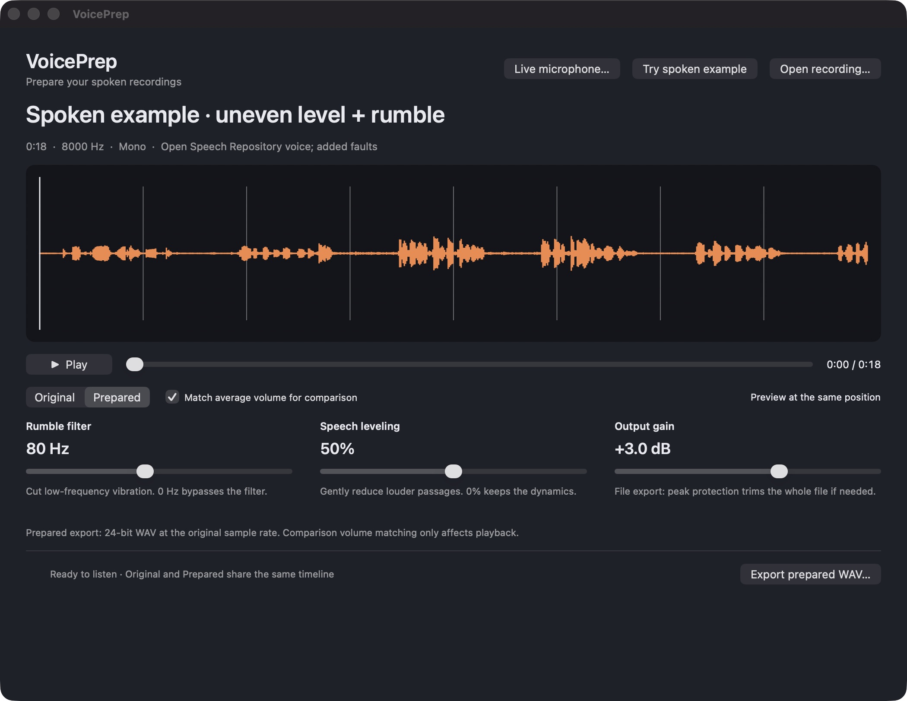

# VoicePrep

A native Mac app for preparing spoken recordings: reduce low rumble, gently reduce louder passages, compare the sound, and export a prepared WAV.

**First release, v0.1.0.** C++17 audio engine and a C++23 Audio Unit target; Objective-C++/AppKit interface and Apple's audio file/playback frameworks. Built by Aymen Al-Tahmschi with Codex assistance.



## A concrete task

You have a recorded presentation or interview whose voice level varies and which contains low-frequency vibration. Open it, adjust the three controls, listen to Original and Prepared at the same playback position, and export a WAV for your editor.

Use the standalone app for existing recordings, **Live microphone…** to hear a processed microphone, or the **VoicePrep Audio Unit** as an insert in an AUv2-compatible Mac recording host. No cloud service or AI API is used. This release does not provide VST, Windows support, a virtual microphone device, or system-wide call processing.

## Build and run

On macOS 13+ with current Apple Command Line Tools supporting C++23 (locally tested with Apple clang 17):

```sh
sh ./build.sh
```

Open `dist/VoicePrep.app` in Finder. This is a locally ad-hoc-signed build, not a notarized distribution. The included binary is built for the Mac's current architecture; building on another Mac produces that Mac's architecture. The current local build was tested on Apple Silicon.

1. Choose **Open recording…** for a WAV, AIFF, MP3, or M4A file supported by macOS. Inputs must be mono or stereo, 8–192 kHz, at most 24 million samples (about four minutes of stereo at 48 kHz).
2. Play, seek with the waveform or playback slider, and switch between **Original** and **Prepared**. Both playback tracks start on the same device timeline; switching uses a 12 ms volume crossfade.
3. Adjust **Rumble filter**, **Speech leveling**, and **Output gain**. Releasing a slider prepares a new version and pauses playback at the current position.
4. **Match average volume for comparison** attenuates the louder audition using whole-file RMS. It is an approximate comparison aid, not LUFS or perceptual loudness matching. It never changes the exported audio.
5. **Export prepared WAV…** writes 24-bit PCM at the source sample rate and channel count. The native save dialog asks before replacing an existing destination. The writer refuses to replace the source recording, including symlink and hard-link aliases.

Keyboard: Space plays/pauses, Command-O opens, Command-E exports; native sliders support keyboard adjustment.

## Live microphone and Audio Unit

Choose **Live microphone…**, then **Start microphone**, and grant macOS microphone access. The app uses the current macOS input/output devices. It starts muted: enable **Monitor through headphones** only when wearing headphones to avoid speaker feedback. Adjust the three controls in the main window while it runs. The processed peak meter updates live. Stop, close the live window, open a recording, or start file playback to stop the microphone. A device configuration change stops the engine and asks you to start again. This window monitors; it does not record or upload audio.

The app bundles its own Audio Unit, so live mode does not require a separate plug-in installation. To use the plug-in in a DAW, run:

```sh
sh ./install-plugin.sh
auval -v aufx Vprp Aalt
```

This installs `dist/VoicePrep.component` in your user Audio Unit folder, backing up an older VoicePrep component. Restart/rescan your AUv2-compatible host; select **Aymen Al-Tahmschi → VoicePrep** as an audio effect. The host supplies a standard parameter editor for Rumble filter, Speech leveling and Output gain, along with its own bypass, automation and preset/session saving. Use the host’s recording/bounce controls to retain the processed take. AUv2-only; compatibility with every third-party host is not established.

Live and plug-in audio use the same filter/compressor with 20 ms control smoothing and a stereo-linked **5 ms lookahead limiter**, an 80 ms release and a −1 dBFS sample-peak ceiling. The plug-in reports its exact lookahead to the host; hardware, host and OS buffering add further latency. This is not a true-peak limiter. File export uses a whole-file gain trim instead, so its dynamics can differ from live output near the ceiling.

## What the controls do

- **Rumble filter:** second-order Butterworth high-pass, 0–180 Hz. Zero bypasses it. Raising the cutoff can thin a voice; listen while adjusting.
- **Speech leveling:** stereo-linked, feed-forward downward compression. Amount maps to ratios 1:1 through 4:1, with a -24 dBFS threshold, 8 ms gain attack and 180 ms release. Zero preserves dynamics. It reduces louder passages; it does not automatically raise every quiet syllable.
- **Output gain:** -12 to +12 dB after compression.
- **Peak protection:** if the complete prepared file exceeds -1 dBFS sample peak, a single gain trim lowers the entire file. This is an offline protection pass, not a real-time limiter or a true-peak guarantee. No samples are intentionally hard-clipped by the DSP.

Processing does not remove other voices, cancel room reverberation, recover already clipped audio, or establish broadcast loudness compliance. Use the original as your reference and keep it.

## Spoken example

The included human voice is from **[Open Speech Repository](https://www.voiptroubleshooter.com/open_speech/)**. The example deliberately adds 35 Hz rumble and changing speech gain to an 18-second excerpt. It is labeled in the app and reproducible with `python3 examples/prepare_example.py`. The original is 8 kHz telephone-band speech. See [attribution and conditions](examples/ATTRIBUTION.md) and [provenance](examples/provenance.json).

## Engine and CLI

```sh
sh ./build.sh --engine-only
./build/voiceprep-cli input.wav prepared.wav 80 50 3
python3 -B -m unittest discover -s tests -p 'test_*.py' -v
```

The final three arguments are rumble Hz, leveling percent, and output gain dB. The CLI rejects existing destinations and invalid controls, and emits measured render duration, file dimensions, RMS and sample peaks as JSON. These are measurements of a particular input/run, not a latency guarantee.

`Processor::process()` allocates no memory and takes no locks. Coefficients and state are created before processing. `render()` performs allocation, validation, measurement and the final peak pass outside any audio callback. Files are decoded and rendered on a background worker. Preview files are floating-point WAVs to preserve source values; final exports use 24-bit PCM. Temporary previews live in a per-run directory beneath the user's macOS temporary directory and are removed on normal exit; a crash can leave that directory behind.

## Verification

Thirteen offline C++ checks cover bypass, frequency response, compression, linked stereo balance, peak protection, silence, supported sample rates, block invariance and invalid inputs. Fifteen additional real-time checks cover transient protection, linked stereo, exact delay, callback boundaries, rapid automation, nonfinite host input and smoothing. Five native export-safety scenarios prevent overwriting the source, including symlink/hard-link aliases. Four Python integration tests exercise Apple's real file I/O, deterministic speech export, original-file preservation, existing-output rejection and malformed inputs. See [verification](docs/verification.md).

The Audio Unit passed Apple `auval` locally. A real AVAudioEngine host rendered mono/stereo audio and verified sample peaks, restored state and reported latency. The CI workflow runs portable Linux DSP checks and macOS app/plug-in/file I/O checks; [Hosted Linux and macOS verification](https://github.com/aaltahms/voiceprep/actions) has also passed. The first release does not establish that users prefer the processed sound. A listening trial with the owner’s own presentation/interview material remains product validation.
